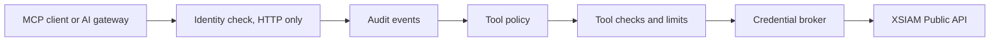

# Cortex XSIAM MCP Gateway

[](https://github.com/ciaran-finnegan/cortex-xsiam-mcp-gateway/actions/workflows/ci.yml)
[](https://github.com/ciaran-finnegan/cortex-xsiam-mcp-gateway/actions/workflows/codeql.yml)
[](https://github.com/ciaran-finnegan/cortex-xsiam-mcp-gateway/actions/workflows/scorecard.yml)

An MCP server between AI agents and the Cortex XSIAM Public API, built on
FastMCP 3.4. It checks who is calling and which tools and datasets they can
use, and audits every tool call. Agents such as Claude Code or Codex send typed
query plans, which the gateway compiles to XQL and runs within row and size
limits.

## Upstream project

This is a community fork of the Palo Alto Networks Cortex MCP server
([overview](https://docs-cortex.paloaltonetworks.com/r/Cortex-XSIAM/Cortex-XSIAM-3.x-Documentation/Cortex-MCP-server-overview),
[announcement](https://www.paloaltonetworks.com/blog/security-operations/introducing-the-cortex-mcp-server/))
and is not supported by Palo Alto Networks. It keeps the upstream XSIAM tools
and adds caller identity over HTTP, tool and dataset policy, restricted raw
XQL, typed dataset queries, role-scoped XSIAM API keys and audit export to
XSIAM.

## Status

Alpha, release line `v0.2.0-alpha.1` (package `0.2.0a1`). Tools and settings
can change between releases. Use least-privilege API keys and test in a
non-production tenant first. Validating identity, policy, the credential broker
and audit export in such a tenant is the last open alpha item. See the
[roadmap](docs/ROADMAP.md), [changelog](CHANGELOG.md) and
[release process](docs/RELEASES.md).

## Tools

Every tool call goes through tool policy and audit. The dataset tools also
check dataset policy.

| Tool | Purpose |
| --- | --- |
| `get_log_search_guidance`, `get_dataset_query_guidance`, `get_xql_help` | Agent workflow, rules and XQL recipes. |
| `set_engagement`, `get_engagement`, `record_fact`, `get_engagement_log` | Session mode (`incident_response`, `threat_hunt`, `operations`), scope and findings tied to queries the session ran. A mode can only narrow access. |
| `list_log_datasets` | Datasets the caller is allowed to query. |
| `discover_log_fields` | Field names and types from a small sample of one dataset, without values. |
| `query_dataset` | Typed row or aggregate query on one dataset, compiled to XQL by the gateway. |
| `continue_dataset_query` | Next page of a row query, from an encrypted cursor. |
| `search_logs` | Older wrapper for simple row searches. |
| `validate_xql` | Checks raw XQL without running it and returns problems, fixes and documentation links. |
| `execute_xql_query` | Raw XQL for privileged groups. |
| `get_xql_query_quota` | XQL quota usage. |
| `get_issues`, `get_cases` | Issues (alerts) and cases. |
| `get_tenant_info`, `get_assets`, `get_asset_by_id`, `get_filtered_endpoints`, `get_vulnerabilities`, `get_assessment_profile_results` | Tenant, asset, endpoint, vulnerability and assessment data. |

## Request path



With an identity mode set, an HTTP request without a valid Entra token or
signed gateway headers gets a 401 before it reaches MCP. See
[architecture](docs/ARCHITECTURE.md).

## Agent workflow

The agent sets the mode and scope with `set_engagement`, calls
`get_dataset_query_guidance`, finds a dataset and its fields with
`list_log_datasets` and `discover_log_fields`, then calls `query_dataset`.
It calls `continue_dataset_query` only when the user wants another page. The
gateway does not accept natural-language queries. A typed plan looks like this.

```json
{
  "dataset": "xdr_data",
  "mode": "aggregate",
  "metrics": [{"function": "count", "alias": "events"}],
  "group_by": ["event_type"],
  "order_by": [{"field": "events", "direction": "desc"}],
  "timeframe": {"from_ms": 1790812800000, "to_ms": 1790899200000},
  "limit": 10
}
```

The gateway checks the caller can query `xdr_data`, compiles the plan from
allowlisted operators and functions, and returns at most 10 groups. `dry_run`
returns the XQL instead. See [agent dataset queries](docs/AGENT_LOG_SEARCH.md).

## Checking raw XQL

`validate_xql` checks a raw query without running it: the `| limit N` stage,
dataset policy and whether the dataset exists, field names against the
dataset's discovered fields, `=` on enum fields, `contains` on IP addresses, and
the timeframe. `corrected_query` applies only fixed rewrites, such as
`contains` to `in (...)` for an address. Each problem links to the matching page
on the [Cortex documentation site](https://cortex-docs.paloaltonetworks.com/),
which the gateway never fetches. With `probe: true` it also runs the query over
one hour with `| limit 1`, which needs the raw XQL grants.

When XSIAM rejects a query, the gateway returns a class (`unknown_field`,
`unknown_dataset`, `syntax_error`, `type_mismatch` or `timeframe_invalid`) and a
fixed message instead of XSIAM's text. Other errors are still returned only as
a hash. See [XQL validation](docs/XQL_VALIDATION.md).

## Engagement modes

Before its first query the agent records what kind of work the session is. It
infers the mode when the request makes it obvious, and otherwise asks the user
one short question.

| Mode | Request | Defaults |
| --- | --- | --- |
| `incident_response` | An indicator list, an alert storm, "are we talking to X" | 24-hour window, rows |
| `threat_hunt` | "Look for", "hunt", a hypothesis | 7-day window, aggregates |
| `operations` | "Why is X failing, blocked or slow", a firewall or integration diagnosis | 1-hour window, aggregates, no raw XQL |

Until a mode is set the session runs as `unset` with the `operations` defaults,
and each result ends with a one-line reminder. `set_engagement` stores the case
id, indicators, internal ranges, front ends, servers and window once, so the
agent does not repeat them in every query. Scope values must be IPs, CIDRs,
hostnames or file hashes. `record_fact` stores a finding with the `query_id`
that supports it. `get_engagement_log` returns the facts and every query the
session ran, with dataset, window, rows, units and duration.

A mode can only hide tools that groups grant. It never adds a tool or dataset.
Session state is tied to the caller as well as the MCP session. Set
`ENGAGEMENT_STORE_DIR` to keep cases across sessions. It must be outside any git
working tree. See [engagement modes](docs/ENGAGEMENT_MODES.md).

## Access control

| Check | Setting | Default |
| --- | --- | --- |
| Caller identity, HTTP | `MCP_IDENTITY_AUTH_MODE` (`none`, `entra`, `gateway`, `entra_or_gateway`) | `none` |
| Tool access | `TOOL_ACCESS_POLICY` | Every tool for `Admin` and `Security`. Query, discovery, quota, case, issue and engagement tools for `SOC` and `Tier1`. |
| Dataset access | `LOG_SEARCH_DATASET_POLICY` | `{"Security": ["*"], "SOC": ["xdr_data"], "Tier1": ["xdr_data"]}` |
| Raw XQL | `RAW_XQL_PRIVILEGED_GROUPS` and a `*` dataset grant | `Security,Admin` |
| XSIAM API key | `XSIAM_CREDENTIAL_BROKER_ENABLED`, `XSIAM_CREDENTIAL_PROFILES` | Off, one service key for every caller |

Groups come from the Entra `groups` and `roles` claims or from HMAC-signed,
single-use gateway headers.

With identity mode `none`, the only mode stdio supports, callers get
`LOG_SEARCH_DEFAULT_GROUPS`. It is empty by default, so every call is denied
until it is set. HTTP will not start with `none` unless
`MCP_ALLOW_UNAUTHENTICATED_HTTP=true`. `tools/list` shows only the tools the
caller's groups and current mode allow, and hidden tools are denied on call.
The `operations` and `unset` modes hide `execute_xql_query`.

Raw XQL needs the `*` grant because the gateway does not parse it for datasets.
It must end in `| limit N`, which is clamped to the server row limit. Comments
are stripped first, so a limit written inside a comment does not count.

Typed queries are capped on rows, fields, filters, cell length, response size
and timeframe, and at most four XQL queries run at once per process.
`query_dataset` marks its results as untrusted data. Continuation cursors are
encrypted, expire, and only work for the same principal, tenant, groups,
dataset policy, mode and case. See the [security model](docs/SECURITY_MODEL.md) and
[RBAC review](docs/RBAC_AND_LOG_SEARCH_REVIEW.md).

## Query cost

XSIAM charges API queries in compute units from a daily budget that the
gateway shares with other API keys and playbooks. When it runs out, every
query fails until 00:00 UTC. Every query therefore needs a timeframe, and the
cost guard rates it light, medium, heavy or extreme before sending it. It
refuses a query that:

- is estimated above the approval threshold, until the analyst approves it;
- would leave less than the reserve for automation, which approval cannot
  override;
- is heavy while two other queries have run for more than 60 seconds.

The approval threshold and reserve come from the engagement mode: 5 and 10
units for `incident_response`, 3 and 15 for `threat_hunt`, and 1 and 20 for
`operations` and `unset`.

A refusal returns `error: "cost_guard"` with the estimate and cheaper
rewrites: a shorter window, a host filter, counts instead of rows, a cheaper
dataset, or the same XQL for the console. Approval comes from an MCP
elicitation prompt when the client supports one, otherwise from an `approval`
argument the analyst types, capped per person per day. Each result carries a
`quota` block with the estimate, the units spent and the units left.
Identical queries from the same caller are served from a 10-minute cache.
Timeouts are capped at 120 seconds, or 300 with approval.

The cache, approval totals and quota tracking are kept per gateway process,
not shared across replicas. See
[configuration](docs/CONFIGURATION.md#xql-cost-guard) and the
[security model](docs/SECURITY_MODEL.md#known-gaps).

## Audit logging

Every tool call, denied ones included, writes JSON start and end events to the
`cortex_xsiam_mcp.audit` logger with the principal, groups, tool, outcome,
duration, argument names and hash, dataset, XSIAM credential profile,
engagement mode, case id and source, and the class of any failed XQL query.
Query text is kept as a SHA-256 hash unless `AUDIT_LOG_INCLUDE_QUERY_TEXT=true`,
and error messages are always hashed.

`AUDIT_LOG_XSIAM_HTTP_COLLECTOR_*` sends events to an
[XSIAM HTTP log collector](https://docs-cortex.paloaltonetworks.com/r/Cortex-XSIAM/Cortex-XSIAM-3.x-Documentation/Set-up-an-HTTP-log-collector-to-receive-logs).
A failed export does not block the call unless `AUDIT_LOG_FAIL_CLOSED=true`.
Cost guard refusals, approvals and elicitation answers are written as separate
`cortex_xsiam_mcp.cost_guard` events.
See [audit logging](docs/AUDIT_LOGGING.md).

## Local development

Requires Python 3.12 or 3.13 and Poetry.

```bash
poetry env use python3.12
poetry install
cp .env.example .env
```

Fill in the three `CORTEX_MCP_PAPI_*` values (tenant API URL, API key, key ID)
in `.env`, which git ignores. `.env.example` is set up for HTTP with Entra, so a
local stdio session overrides three settings. Environment variables take
precedence over `.env`.

```bash
MCP_TRANSPORT=stdio MCP_IDENTITY_AUTH_MODE=none LOG_SEARCH_DEFAULT_GROUPS=Tier1 \
  poetry run python src/main.py
```

`Tier1` can query `xdr_data` and `Security` can use everything. Run it from
the repository root, where `.env` and `src/main.py` are found.

`poetry run pytest -q` runs the tests on synthetic data. Live XSIAM tests need
`--run-live`. See
[agent and XSIAM testing](docs/CLAUDE_CODE_LOG_SEARCH_TESTING.md).

## HTTP deployment

For direct Entra mode, add these to the `CORTEX_MCP_PAPI_*` values.

```bash
MCP_TRANSPORT=streamable-http
MCP_IDENTITY_AUTH_MODE=entra
ENTRA_TENANT_ID=replace-with-tenant-id
ENTRA_AUDIENCE=api://your-mcp-app-registration
DATASET_QUERY_CURSOR_SECRET=replace-with-a-long-random-secret
```

Map the tool, dataset and raw XQL policies to the group IDs or app roles in
your tokens. Default names such as `Tier1` only match tokens that carry them.
The server listens on plain HTTP at `0.0.0.0:8080`, path `/api/v1/stream/mcp`,
with a health check at `/ping/`, so terminate TLS in front of it.

An AI gateway such as Portkey or LiteLLM is optional. In `gateway` mode it has
to send identity headers signed with `MCP_GATEWAY_SHARED_SECRET`, and the
server should only be reachable from it.

Query concurrency, the gateway nonce cache and the `ENGAGEMENT_STORE_DIR` case
store are per process, so they do not span replicas. See [enterprise deployment](docs/ENTERPRISE_DEPLOYMENT.md) and
[configuration](docs/CONFIGURATION.md).

## Docker

```bash
docker build -t cortex-xsiam-mcp-gateway .
docker run --rm -p 8080:8080 --env-file .env cortex-xsiam-mcp-gateway
```

The image runs `python src/main.py` as a non-root user and serves HTTP only if
the env file sets `MCP_TRANSPORT=streamable-http` and an identity mode, as
`.env.example` does. For stdio, run it with `docker run -i` and the three
overrides above as `-e` flags.

## Contributing and security

Report vulnerabilities through GitHub private vulnerability reporting, as set
out in [SECURITY.md](SECURITY.md). See [CONTRIBUTING.md](CONTRIBUTING.md),
[GOVERNANCE.md](GOVERNANCE.md) and the [code of conduct](CODE_OF_CONDUCT.md).

GitHub Actions run CI, CodeQL, Scorecard and Dependency Review. Dependabot
sends weekly pip and Actions updates and enables auto-merge on patch and minor
ones. Claude and Codex reviews run when their API key secret is set. See
[dependency remediation](docs/DEPENDENCY_REMEDIATION.md) and
[AI review](docs/AI_REVIEW.md).

## Licensing

The upstream Palo Alto Networks code is under the Palo Alto Networks Cortex
Communication Python Files License 1.0 ([LICENSE](LICENSE)), which allows
derivative works only for use with Cortex XSIAM, Cortex Cloud, Cortex XDR and
AgentiX, with conditions on redistribution. Separable additions in this fork
(documentation, tests, workflow configuration and original glue code for
dataset policy and gateway hardening) are offered under
[Apache-2.0](LICENSES/Apache-2.0.txt) where legally separable. The combined
repository is still bound by the upstream license. See [NOTICE](NOTICE.md).
This summary is not legal advice.
