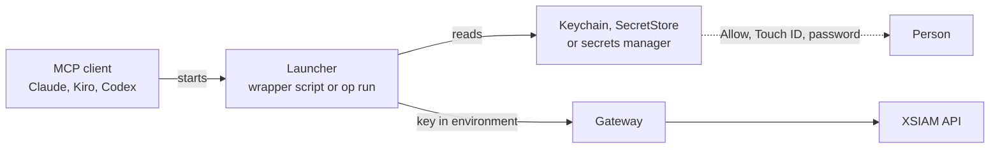
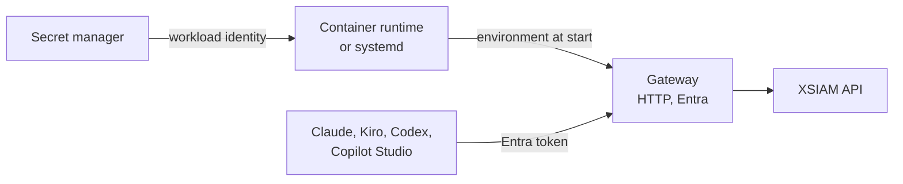

# Secrets And API Keys

The gateway reads the XSIAM API key from environment variables. Where the key
waits between runs depends on where the gateway runs. On a workstation it
belongs in the operating system's credential store, or a secrets manager, that
asks a person before releasing it. On a server it belongs in the platform's
secret manager, released to the workload's identity. It never belongs in
`.env`, which is plaintext, readable by every process running as you, copied
with the folder and one `git add` from a public commit. The key is a bearer
credential, whoever holds it reads whatever its role allows until it is
revoked, and the audit log then names the gateway's principal rather than the
person who took it.

Contents

- [Secret Settings](#secret-settings)
- [Workstation](#workstation)
  - [Option 1: macOS Keychain](#option-1-macos-keychain)
  - [Option 2: Windows SecretStore](#option-2-windows-secretstore)
  - [Option 3: A Secrets Manager CLI](#option-3-a-secrets-manager-cli)
  - [Linux](#linux)
  - [MCP Clients](#mcp-clients)
- [Server](#server)
- [Checklist](#checklist)
- [Verification](#verification)

## Secret Settings

| Variable | Use |
| --- | --- |
| `CORTEX_MCP_PAPI_AUTH_HEADER` | The XSIAM API key. |
| `CORTEX_MCP_PAPI_AUTH_ID` | The key id. An identifier, kept with the key. |
| Variables named by `api_key_env` and `api_key_id_env` in `XSIAM_CREDENTIAL_PROFILES` | Role-scoped keys for the credential broker. |
| `DATASET_QUERY_CURSOR_SECRET` | Encrypts continuation cursors. |
| `MCP_GATEWAY_SHARED_SECRET` | HMAC key for signed gateway identity headers. |
| `AUDIT_LOG_XSIAM_HTTP_COLLECTOR_API_KEY` | Writes to the tenant's HTTP log collector. |
| `XSIAM_LIVE_API_KEY`, `XSIAM_LIVE_API_KEY_ID` | Live test suite credentials. |

`CORTEX_MCP_PAPI_URL` names your tenant, keep it out of anything you publish.
pydantic-settings reads the process environment first, then `.env` in the
working directory, and the environment wins, so `.env` keeps the non-secret
settings and the launcher supplies the rest. `src/cli.py start` also accepts
`--api_key_secret`, do not use it, arguments show in the process list and in
shell history.

## Workstation

One analyst, one key, the MCP client starts the gateway over stdio. A launcher
reads the key from a store that asks the person, puts it in the gateway's
environment, and nothing else sees it.



Each option has two modes. Approval on every use is recommended, the store
asks the person each time the client starts the gateway. Approval for the MCP
is the pragmatic mode, the store releases the key silently while you are
logged in and the login password and screen lock are the gate. Choose per
machine, a shared or travelling laptop gets the first.

### Option 1: macOS Keychain

```bash
security add-generic-password -a "$USER" -s cortex-xsiam/dev/api-key \
  -l "Cortex XSIAM dev API key" -j "Tier1 read-only, created 2026-11-05" -T "" -U -w
security add-generic-password -a "$USER" -s cortex-xsiam/dev/api-key-id \
  -l "Cortex XSIAM dev API key id" -T "" -U -w
```

`security` prompts twice and does not echo. `-w` must be the last argument,
anything after it, including a keychain path, is stored as the password, so
the items go in the login keychain. `-U` updates an existing item, which is how
you rotate. Without `-w`, `security find-generic-password -a "$USER" -s
cortex-xsiam/dev/api-key` confirms an item exists without showing it.

Modes:

- Every use: `-T ""`, as above. Each read shows the dialog "security wants to
  use your confidential information", choose Allow. Always Allow switches the
  item to the second mode.
- For the MCP: `-T /usr/bin/security` in place of `-T ""`. Reads through the
  `security` tool need no dialog while the keychain is unlocked, and any script
  running as you can read the item the same way.

The login keychain stays unlocked after login. `security set-keychain-settings
-l -u -t 900 ~/Library/Keychains/login.keychain-db` locks it on sleep and after
fifteen idle minutes, for every item in it, so other applications will ask for
your login password too.

The launcher, saved outside the repository or untracked, `chmod +x`:

```sh
#!/bin/sh
# Starts the gateway with the XSIAM key read from the login keychain.
set -eu
cd /path/to/cortex-xsiam-mcp-gateway
CORTEX_MCP_PAPI_AUTH_HEADER="$(security find-generic-password -a "$USER" -s cortex-xsiam/dev/api-key -w)"
CORTEX_MCP_PAPI_AUTH_ID="$(security find-generic-password -a "$USER" -s cortex-xsiam/dev/api-key-id -w)"
export CORTEX_MCP_PAPI_AUTH_HEADER CORTEX_MCP_PAPI_AUTH_ID
exec .venv/bin/python src/main.py
```

The dialog is graphical, so it appears when a desktop client starts the
server. Register the script as the client's command, see [MCP Clients](#mcp-clients).

### Option 2: Windows SecretStore

Credential Manager's `cmdkey` can write a secret but not read one back, and
`cmdkey /pass:` puts the key in the process list and history. Use Microsoft's
[SecretManagement](https://learn.microsoft.com/en-us/powershell/utility-modules/secretmanagement/overview)
and [SecretStore](https://learn.microsoft.com/en-us/powershell/utility-modules/secretmanagement/how-to/manage-secretstore)
modules, an encrypted per-user store, in PowerShell 7.

```powershell
Install-Module Microsoft.PowerShell.SecretManagement, Microsoft.PowerShell.SecretStore -Scope CurrentUser
Register-SecretVault -Name CortexXsiam -ModuleName Microsoft.PowerShell.SecretStore -DefaultVault
Set-Secret -Name CortexXsiamDevApiKey -Secret (Read-Host -AsSecureString 'XSIAM API key')
Set-Secret -Name CortexXsiamDevApiKeyId -Secret (Read-Host -AsSecureString 'XSIAM API key id')
```

The first command that touches the store asks you to choose its password.
`Read-Host -AsSecureString` hides the input, `Get-SecretInfo` lists names
without values.

Modes:

- Every use: `Set-SecretStoreConfiguration -Authentication Password
  -Interaction Prompt -PasswordTimeout 60`. The store asks for its password
  when it has been locked for a minute. The prompt is console only, so this
  mode works from a terminal. A desktop client has no console, `Get-Secret`
  then fails with `PasswordRequiredException`, and `Unlock-SecretStore` in
  another window does not help because the unlock is per session.
- For the MCP: `Set-SecretStoreConfiguration -Authentication None -Interaction
  None`. No prompt, the store key sits in your profile protected by your
  Windows logon. This is the mode for Claude Desktop or Kiro on Windows without
  a secrets manager.

The launcher, `run-gateway.ps1`:

```powershell
$ErrorActionPreference = 'Stop'
Set-Location 'C:\src\cortex-xsiam-mcp-gateway'
$env:CORTEX_MCP_PAPI_AUTH_HEADER = Get-Secret -Name CortexXsiamDevApiKey -AsPlainText
$env:CORTEX_MCP_PAPI_AUTH_ID = Get-Secret -Name CortexXsiamDevApiKeyId -AsPlainText
& .\.venv\Scripts\python.exe src\main.py
```

Run it with `pwsh -NoProfile -File run-gateway.ps1`, or register that as the
client's command.

### Option 3: A Secrets Manager CLI

A secrets manager CLI resolves references at start and passes the values to one
child process, nothing is written to disk, and the manager's own unlock is the
approval. 1Password CLI is the example here. Bitwarden Secrets Manager
(`bws run`), Doppler (`doppler run`), Infisical (`infisical run`) and HashiCorp
Vault Agent follow the same pattern, a run command, a reference file and an
unlock prompt or token. Use the one your organisation already runs.

[1Password CLI](https://developer.1password.com/docs/cli/) with the
[desktop app integration](https://developer.1password.com/docs/cli/app-integration/)
unlocks the way the app does, Touch ID, Windows Hello or the account password,
and `op` waits while the app is locked.

Store the key as an API Credential item in a vault shared only with the people
who run the gateway, e.g. `XSIAM dev tenant Tier1`, key in `credential`, text
fields `auth_id` and `url`. From a terminal, read it at a hidden prompt:

```bash
stty -echo; printf 'XSIAM API key: '; read -r KEY; stty echo; printf '\n'
printf '%s' "$KEY" | jq -Rs \
  --arg title "XSIAM dev tenant Tier1" \
  --arg url "https://api-your-xsiam-tenant.example" \
  --arg id "12" \
  '{title: $title, category: "API_CREDENTIAL", fields: [
     {id: "credential", type: "CONCEALED", label: "credential", value: .},
     {id: "auth_id", type: "STRING", label: "auth_id", value: $id},
     {id: "url", type: "STRING", label: "url", value: $url}]}' \
  | op item create --vault "Security Engineering" - --format json \
  | jq -r '"stored \(.vault.name)/\(.id)"'
unset KEY
```

Copy `.env.op.example` to `.env.op` (git ignores `.env.*`) and edit. Titles
repeat, so in a shared file use the item id,
`op item get "<title>" --format json | jq -r .id`. Broker profiles get one line
per variable named in `XSIAM_CREDENTIAL_PROFILES`.

```bash
CORTEX_MCP_PAPI_URL=op://Security Engineering/XSIAM dev tenant Tier1/url
CORTEX_MCP_PAPI_AUTH_HEADER=op://Security Engineering/XSIAM dev tenant Tier1/credential
CORTEX_MCP_PAPI_AUTH_ID=op://Security Engineering/XSIAM dev tenant Tier1/auth_id
```

Run:

```bash
MCP_TRANSPORT=stdio MCP_IDENTITY_AUTH_MODE=none LOG_SEARCH_DEFAULT_GROUPS=Tier1 \
  op run --env-file=.env.op -- poetry run python src/main.py
```

```powershell
$env:MCP_TRANSPORT = 'stdio'; $env:MCP_IDENTITY_AUTH_MODE = 'none'; $env:LOG_SEARCH_DEFAULT_GROUPS = 'Tier1'
op run --env-file=.env.op -- poetry run python src/main.py
```

Docker on a workstation, `-e NAME` with no value copies the variable from the
environment `op run` populated, and the `.env` passed to `--env-file` holds
non-secret settings only:

```bash
op run --env-file=.env.op -- docker run --rm -i \
  -e CORTEX_MCP_PAPI_URL -e CORTEX_MCP_PAPI_AUTH_HEADER -e CORTEX_MCP_PAPI_AUTH_ID \
  --env-file .env cortex-xsiam-mcp-gateway
```

Modes:

- Every use: a short auto-lock in the 1Password app (Settings, Security). `op`
  prompts whenever the app is locked, so each gateway start prompts.
- For the MCP: a longer auto-lock, one approval lasts until the app locks. The
  prompt is graphical on Windows too, so this option works from desktop
  clients where Option 2 cannot prompt.

Notes:

- `op run` masks every resolved value in the output, so a short key id such as
  `12` disappears wherever those digits appear. If that corrupts logs, move
  `CORTEX_MCP_PAPI_AUTH_ID` to `.env`, it is an identifier. `--no-masking`
  also unmasks the key, do not use it.
- A locked app blocks until someone approves, wrap scripted runs in `timeout`.
- No `op read` into a terminal and no `--reveal`, transcripts are stored.

### Linux

[`secret-tool`](https://manpages.debian.org/testing/libsecret-tools/secret-tool.1.en.html)
(libsecret) stores items in GNOME Keyring or KWallet and prompts for the value
in a terminal. The keyring unlocks with your login session and does not prompt
per read, so this is the "for the MCP" mode only. 1Password CLI runs on Linux
and prompts through the system authentication dialog.

```bash
secret-tool store --label="Cortex XSIAM dev API key" service cortex-xsiam key dev-api-key
CORTEX_MCP_PAPI_AUTH_HEADER="$(secret-tool lookup service cortex-xsiam key dev-api-key)"
```

### MCP Clients

Client config files are plaintext too, never put the key in their `env` block.
The launcher is the command, the wrapper script from Option 1 or 2, or `op run`
from Option 3. The gateway reads `.env` from the working directory, so the
launcher runs from the repository root, and the three non-secret stdio settings
go in `env`. Desktop apps start with a short `PATH`, use full paths
(`/opt/homebrew/bin/op`, `/usr/local/bin/op`,
`C:\Program Files\1Password CLI\op.exe`). If nobody approves before the client's
start-up timeout the server fails to start, approve and reconnect it.

Claude Code:

```bash
claude mcp add cortex-xsiam \
  -e MCP_TRANSPORT=stdio -e MCP_IDENTITY_AUTH_MODE=none -e LOG_SEARCH_DEFAULT_GROUPS=Tier1 \
  -- sh -c 'cd /path/to/cortex-xsiam-mcp-gateway && exec op run --env-file=.env.op -- .venv/bin/python src/main.py'
```

With the Keychain launcher, the command is the script:
`claude mcp add cortex-xsiam -e ... -- /path/to/run-gateway.sh`.

Claude Desktop (`claude_desktop_config.json`) and Kiro (`.kiro/settings/mcp.json`
in the workspace, or `~/.kiro/settings/mcp.json`) take the same JSON:

```json
{
  "mcpServers": {
    "cortex-xsiam": {
      "command": "sh",
      "args": [
        "-c",
        "cd /path/to/cortex-xsiam-mcp-gateway && exec op run --env-file=.env.op -- .venv/bin/python src/main.py"
      ],
      "env": {
        "MCP_TRANSPORT": "stdio",
        "MCP_IDENTITY_AUTH_MODE": "none",
        "LOG_SEARCH_DEFAULT_GROUPS": "Tier1"
      }
    }
  }
}
```

Codex CLI (`~/.codex/config.toml`):

```toml
[mcp_servers.cortex-xsiam]
command = "/path/to/run-gateway.sh"
env = { MCP_TRANSPORT = "stdio", MCP_IDENTITY_AUTH_MODE = "none", LOG_SEARCH_DEFAULT_GROUPS = "Tier1" }
```

Windows, any client: `"command": "pwsh"`,
`"args": ["-NoProfile", "-File", "C:\\src\\run-gateway.ps1"]`, or with
1Password `"args": ["-NoProfile", "-Command", "Set-Location C:\\src\\cortex-xsiam-mcp-gateway; op run --env-file=.env.op -- .venv\\Scripts\\python.exe src\\main.py"]`.

Copilot Studio connects to MCP servers over streamable HTTP through a connector
and cannot start a local process, so it uses a hosted gateway with
`MCP_IDENTITY_AUTH_MODE=entra`, see [Server](#server).

## Server

A shared gateway runs over HTTP with an identity mode, see
[Enterprise Deployment](ENTERPRISE_DEPLOYMENT.md). No person is present, so the
workload's identity (IAM role, managed identity, service account) fetches the
key from the platform's secret manager at start and the runtime puts it in the
environment. Never bake it into the image, a plain `environment` block, a task
definition, or a `.env` on the host.



| Where | Store | Injection |
| --- | --- | --- |
| AWS ECS, Fargate | Secrets Manager or SSM Parameter Store | Task definition `secrets` with `valueFrom`, read by the task role. |
| AWS EKS, any Kubernetes | Secrets Manager or the cluster's store | Secrets Store CSI driver or External Secrets Operator into a Secret, mapped to env. |
| Azure Container Apps | Key Vault | App secret with a Key Vault reference, read by the managed identity, mapped to env. |
| AKS | Key Vault | Secrets Store CSI driver, as above. |
| GCP Cloud Run | Secret Manager | `--set-secrets ENV=name:version`, read by the service account. |
| GKE | Secret Manager | Secret Manager add-on or External Secrets, as above. |
| Docker or Compose on a host | The cloud secret manager, or a 1Password service account | A start wrapper fetches with the host's identity and `exec`s the gateway. Compose `secrets:` mounts files and the gateway reads env only, so the wrapper reads the file. |
| Native on a VM | The cloud secret manager | A systemd unit runs a wrapper that fetches with the instance identity and `exec`s `python src/main.py`. No `EnvironmentFile` on disk. |

The same store holds `DATASET_QUERY_CURSOR_SECRET`, which must be the same on
every replica, `MCP_GATEWAY_SHARED_SECRET`, the collector key, and the
role-scoped keys the credential broker names in `XSIAM_CREDENTIAL_PROFILES`.
Rotate in the store and restart. A 1Password [service account](https://developer.1password.com/docs/service-accounts/)
scoped to one vault (`OP_SERVICE_ACCOUNT_TOKEN`) is the unattended form of
Option 3. In GitHub Actions map encrypted secrets to job environment variables,
the live tests read `XSIAM_LIVE_*` from the environment only.

## Checklist

- `git ls-files | grep '^\.env'` lists only `.env.example` and
  `.env.op.example`.
- `.env` holds no `*_AUTH_HEADER`, `*_KEY`, `*_SECRET` or `*_API_KEY` value.
  `chmod 600 .env` anyway, it names your tenant.
- Secrets are typed at hidden prompts (`-w` last, `Read-Host -AsSecureString`,
  `stty -echo`), never on a command line, and never in a client's `env` block.
- One key per person or role, least privilege, separate dev and prod tenants,
  rotated. Revoke a leaked key under Settings, Configurations, API Keys.
- Nothing prints a secret: no `printenv`, `op read`, `--reveal`,
  `--no-masking` or `find-generic-password -w` in a visible terminal.

## Verification

Start the gateway and call `get_tenant_info` or `get_xql_query_quota` from the
client. A wrong or missing key fails with an authentication error from XSIAM,
and `src/cli.py start` refuses to start without one. Audit events record the
credential profile, never the key.
