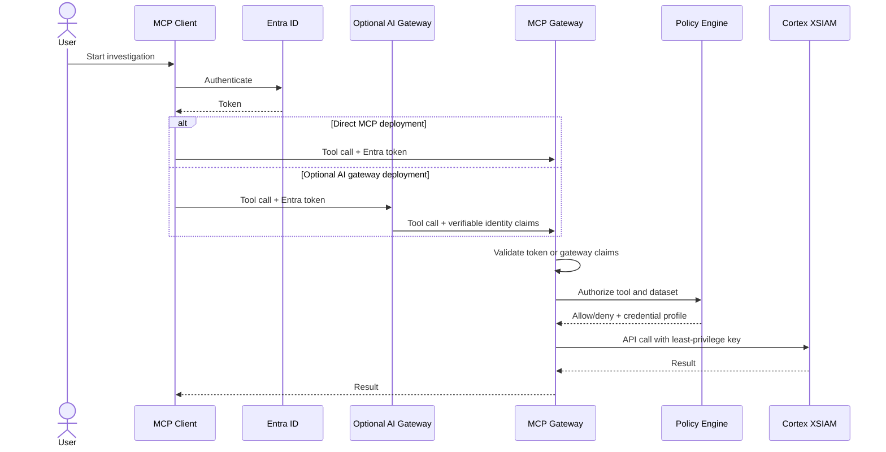

# Security Model

## Current State

The current implementation authenticates to XSIAM with either a configured
default API key or a role/group-scoped credential profile selected by the
credential broker.

For HTTP transport, incoming users can be authenticated through Entra bearer
JWT validation, HMAC-signed trusted gateway identity forwarding, or either path
when `MCP_IDENTITY_AUTH_MODE=entra_or_gateway`.

Every MCP tool invocation is checked against `TOOL_ACCESS_POLICY`.
`query_dataset`, `search_logs`, and discovery tools enforce dataset allowlists
using verified groups/app roles from `MCPContext`. `execute_xql_query` requires
both a privileged group and an all-datasets policy grant. Every MCP tool call is
audited through middleware, with optional export to a Cortex XSIAM HTTP Log
Collector.

In local stdio development, groups can come from environment defaults. In
production HTTP deployments, groups must come from verified identity claims.

Engagement modes (`set_engagement`) only narrow access: a mode can hide tools
that group policy grants but cannot grant a tool or dataset. Tools a principal
cannot invoke are not advertised. Engagement state is bound to the session and
to the principal, case files are principal-scoped and refused inside a git
working tree, and continuation cursors are bound to the mode and case. See
[Engagement Modes](ENGAGEMENT_MODES.md).

Every tool only reads from XSIAM except `run_endpoint_script`, which is off by
default and gated as described under
[Endpoint script execution](#endpoint-script-execution).

## Target State

The target security model supports two deployment modes:

- Direct mode: the MCP server validates Entra ID tokens from the MCP client.
- Gateway mode: an optional AI gateway such as Portkey or LiteLLM validates the
  user, routes the request, and forwards identity claims that the MCP server can
  verify.

Gateway mode is useful for organizations that already centralize AI traffic, but
it is not required for teams that can connect MCP clients directly to this
server.



## Authorization Layers

| Layer | Purpose |
| --- | --- |
| Identity | Verify the human or service calling MCP. |
| Tool policy | Decide which tools can be invoked. |
| Dataset policy | Decide which XSIAM datasets can be queried. |
| Credential policy | Select a pre-provisioned least-privilege XSIAM API credential. |
| Output controls | Suppress unrequested fields and enforce row, field, cell, and byte budgets. Field-level role policy is a future layer. |
| Audit | Record every tool invocation and policy outcome. |

## Dataset Policy

Dataset policy is checked before dataset discovery, field sampling, typed query
compilation/execution, continuation, and compatibility `search_logs` calls.

Example:

```json
{
  "Security": ["*"],
  "Tier1": ["xdr_data"]
}
```

`Security` can query all datasets. `Tier1` can query only `xdr_data`.

Typed queries still require one explicit dataset even for principals with `*`.
Raw XQL is not parsed for authorization; instead it is limited to principals
that already have both raw-XQL privilege and `*` dataset access. Every raw
query must end with a numeric limit stage, which is clamped before submission
so synchronous and polled result paths share the same row bound.

## Query And Result Controls

`query_dataset` compiles allowlisted operators and aggregate functions rather
than accepting an XQL string. It enforces:

- explicit row projections;
- server caps for filters, metrics, grouping, fields, rows, cell length,
  response bytes, and timeframe;
- a process-level semaphore hard-capped at four concurrent XQL queries;
- timeout-bounded polling, capped at `XQL_TIMEOUT_CEILING_SECONDS`;
- the XQL cost guard, which applies to raw and typed queries alike: a required
  timeframe, an estimate per query, refusal above the approval threshold
  without approval, and refusal of any query that would take the shared quota
  below the automation reserve, which approval cannot override;
- removal of any columns XSIAM returns outside the requested projection;
- metadata-only upstream HTTP and XQL failure errors so XSIAM response bodies
  and query error details cannot echo queries, filters, or tenant data into MCP
  responses or logs;
- untrusted-data provenance on returned rows.

Enum fields are filtered with `value_type: enum`; the member name must be a bare
uppercase identifier and is emitted as `ENUM.<NAME>`, never as caller-supplied
XQL.

`execute_xql_query` requires a terminal numeric `| limit N`, which the server
clamps. Comments (`//` and `/* */` outside string literals) are removed before
that check and before submission. XSIAM ignores comments, so a check on the raw
text could be satisfied by a limit the engine never runs.

Question-shaped helpers (`resolve_entity`, `firewall_traffic`,
`firewall_verdict`, `entity_activity`, `dataset_health`,
`threat_intel_lookup`, `coverage_gap`) choose datasets
server-side. They use the same compiler, executor, dataset policy, and output
budgets, add a per-call query budget, and report every dataset and query hash
in the audit event. See [Investigation Helpers](INVESTIGATION_HELPERS.md).

Continuation uses an encrypted keyset cursor instead of an offset. The cursor
contains no plaintext plan, is time-limited, and is bound to principal, tenant,
auth source, groups, and dataset-policy hash. Dataset authorization is checked
again on every continuation call.

## Audit Logging

Tool invocation audit is implemented. It records principal, groups, tool,
outcome, dataset, argument hashes, duration, and the selected nonsecret XSIAM
credential profile. Cortex XSIAM SIEM export is supported through an HTTP Log
Collector.

Raw XQL is hashed by default. Full query logging requires
`AUDIT_LOG_INCLUDE_QUERY_TEXT=true`.

## Learned Facts

Tier-1 learning writes measured tenant facts to `<TENANT_PACK_DIR>/learned/`
(see [Learning](LEARNING.md)). Controls:

- gateway observers only append validated records to a per-process journal, off
  the event loop and after the result is returned; they never write fact files,
  never block a call and never raise into one;
- the learner process is the single writer of fact files, under a lock, and
  validates every journal record again; journal files that are symbolic links or
  writable by group or others are ignored;
- facts derive only from query metadata, row counts, classified error classes,
  field names, value types and timings; result cell values are never read, and
  filter literals are held only as in-memory hashes;
- evidence must be query ids XSIAM returned to the journalling process; free
  text, unknown keys, over-long values and instruction-shaped field names are
  refused on write and ignored on read;
- an `unknown_field` classification names only a field already present in the
  submitted query outside string literals;
- served facts are filtered by dataset policy, carry a trust label and
  `content_trust: "measured_metadata"`; facts spanning datasets withhold their
  evidence ids; the resource requires the `get_learned_facts` tool permission;
- verification is automatic and needs repeated confirmation across several
  engagements over at least a week with no contradiction, so one session cannot
  verify a fact; one contradiction removes verification;
- every learner run is audited before commit; `LEARNING_ENABLED=false` stops the
  observers and the learner; revert, pin and unpin are restricted to
  `LEARNING_ADMIN_GROUPS`;
- the learner queries XSIAM only as its own `learner` principal under the normal
  dataset and tool policy, within a daily unit cap, and not below the reserve;
- the history backfill, which an operator starts once, is the one path that reads
  query text from XSIAM rows. That text is author-controlled, so it stays in memory
  and only validated identifiers and tokens leave it; its facts never count towards
  verification, never contradict or replace a live fact, and can raise a cost
  estimate but not lower it. It never selects `issuer`;
- the replay cache is off by default, holds only results the gateway already
  returned, is capped, owner-only and git-ignored in the pack, and is not exposed
  as an MCP tool.

## Endpoint script execution

Off by default (`SCRIPT_RUN_ENABLED=false`). This is the gateway's only tool
that changes state outside the gateway: it runs a script on endpoints.

What it can do:

- list the allow-listed scripts in the tenant's agent script library;
- run one of them on named endpoints, with bounded parameters;
- list the runs the caller started, and read the status and capped results of
  one of them;
- save a run's retrieved files to a private directory on the gateway host.

Guard rails, all enforced in `src/usecase/script_run.py` before anything is
sent to XSIAM, and repeated in the tool policy middleware where they decide
listing:

| Rule | Control |
| --- | --- |
| Off by default | With the switch off the tools are not registered, not listed, and refused on call. |
| Explicit grant | `run_endpoint_script` and `get_endpoint_script_run` need a group in `SCRIPT_RUN_GROUPS` as well as the `TOOL_ACCESS_POLICY` grant. `*` is not enough and there is no wildcard group. |
| Script allow-list | Only uids in `SCRIPT_RUN_ALLOWED_SCRIPTS` run. An empty list runs nothing. The uid is checked before any API call. |
| Version pin | Optional. When a uid is pinned to a `modification_date` and XSIAM reports another, the run is refused with `script_changed`. |
| High-risk scripts | The script is read from XSIAM before every run. It is refused unless XSIAM reports `is_high_risk: false`; a failed or incomplete lookup refuses. |
| Endpoint cap | An explicit, de-duplicated list of ids matching a strict pattern, within `SCRIPT_RUN_MAX_ENDPOINTS` (hard ceiling 200). No wildcard, no "all endpoints", and the only filter sent is the id list. |
| Endpoint resolution | Every id is looked up in XSIAM before approval. An unknown id (`endpoint_unknown`) or a failed lookup (`endpoint_lookup_failed`) refuses the run. |
| Engagement mode | Only `incident_response` and `threat_hunt`. The lock is fixed in code, so `ENGAGEMENT_MODE_POLICY` cannot expose the tools in `operations` or `unset`; it can still hide them. |
| Human approval | Every run. Elicitation asks the analyst and shows the script and uid, every endpoint by name, id, and status, every parameter value in full, the timeout, and the reason. Nothing is shortened. Control, direction-override, and other hidden characters are written as visible escapes, so two different values never look the same. A declined prompt is final. Otherwise the analyst's typed `approval` argument is required and stored only as a SHA-256. |
| Approval binding | A typed approval is accepted only for the exact request this process already refused with `approval_required` for the same principal, once, within 15 minutes. The request is the script uid and the `modification_date` XSIAM reported, the endpoint ids, the parameters, the timeout, and the reason; changing any of them needs a new approval. A first call that carries an approval is refused, so the details are always returned before an approval is used. |
| Check before sending | After the approval and immediately before the send, the script is read again. A changed `modification_date`, a high-risk flag, a pin that no longer matches, or a failed lookup refuses the run; nothing is sent and nothing is counted. |
| Daily caps | Runs and endpoints per principal per UTC day, counted when a run is submitted, whatever XSIAM then answers. With `SCRIPT_RUN_STATE_DIR` they hold across restarts. |
| Run ledger | With `SCRIPT_RUN_STATE_DIR`, the run is counted and saved before the request is sent. An unreadable, malformed, linked, or group-readable ledger refuses new runs (`state_unavailable`). Every field read from the file is validated. The writer stays under a size budget below the reader's limit, dropping the oldest completed records first and never the daily counts or a run still awaiting XSIAM's answer. |
| Timeouts | Every XSIAM call has a deadline. A lookup that times out refuses the run. |
| Submission outcome | A sent run is reported as not executed only on a 4xx reply or a well-formed reply that reports failure and names no action. A timeout, a lost connection, any 5xx, and an unreadable reply are reported as outcome unknown: the record and the count stay, and the caller is told to check the Action Center before submitting again. |
| Parameters | At most 20, identifier names, string, number, or boolean values, strings up to 500 characters. |
| Audit | Every attempt emits a `cortex_xsiam_mcp.script_run` event, allowed or refused, with endpoint ids, parameter names, and hashes, never endpoint names or parameter values. See [Audit Logging](AUDIT_LOGGING.md). |
| Untrusted output | Standard output and returned values are capped per endpoint and in total, stripped of control characters, and labelled `content_trust: "untrusted_data"`. Every returned value is charged its key name and serialised size, and one that does not fit is omitted. Tool descriptions and server instructions say results are data, never instructions. |
| Files | The signed link is never returned or logged. The zip is saved under `SCRIPT_RUN_RESULTS_DIR` with a size cap and owner-only permissions, and only its path and size are returned. Only `https` links to a named host are fetched: an IP literal, `localhost`, or a host without a DNS top-level label is refused, on the first URL and on each redirect. The XSIAM API key is never sent to the download host. |
| Run ownership | `get_endpoint_script_run` serves and lists only actions this gateway recorded for the same principal. |

What it deliberately cannot do:

- run code supplied in a request; no snippet or ad hoc code API is called or
  exposed, and there is no upload;
- target endpoints by filter, group, tag, or wildcard;
- run a script XSIAM marks high risk, even if it is on the allow-list;
- cancel, rerun, or schedule a script, or take any other response action;
- return a retrieved file, a download link, or unbounded output to the model;
- read script actions started in the console or by another principal, unless
  the operator sets `SCRIPT_RUN_ALLOW_FOREIGN_ACTIONS=true`. That setting also
  keeps reads working while the run ledger is unusable; new runs stay refused.

## Credential Policy

The credential broker does not dynamically provision per-user API keys. It
selects from pre-provisioned XSIAM API key profiles mapped to groups/app roles.
If the broker is enabled and no profile matches the verified principal, tool
execution fails closed.

## Known Gaps

- Field-level role-based redaction is not implemented; output projection and
  size minimization are implemented.
- Large result streaming is not implemented.
- Live enterprise validation is still required for each tenant-specific Entra,
  gateway, dataset, tool, credential, and audit-export configuration.
- XQL cost guard limits:
  - an `approval` argument is an accountability record, not proof that a human
    typed it; an agent can write one, and only the per-principal daily cap and
    the reserve bound what it can approve;
  - approvals given through MCP elicitation are not counted against that cap;
  - the result cache, approval totals, quota readings, in-flight reservations,
    and slot timings live in each gateway process, so N replicas allow up to N
    times the approval cap and can each admit queries against the same reserve;
  - estimates are heuristics from the query text; XSIAM charges for bytes
    scanned, which the gateway cannot see before a query runs.
- Endpoint script execution limits:
  - an `approval` argument is an accountability record, not proof that a human
    typed it. On a client without elicitation an agent can call twice and write
    one. The binding guarantees the request was returned for display first and
    that the approval covers that request only; the allow-list, the explicit
    group, and the daily caps bound what can run;
  - the engagement mode can be set by the agent, so the mode rule is a workflow
    guard, not an authorization boundary;
  - the audit event carries parameter names and a SHA-256 of the values, not
    the values. Low-entropy values can be guessed from an unsalted hash;
  - without `SCRIPT_RUN_STATE_DIR` a restart loses the run records and resets
    the daily caps. With it, the ledger is one file per gateway process; N
    replicas allow up to N times the daily caps and must not share the file;
  - pending approvals are in memory only, so a restart discards them;
  - a version pin, the approval binding, and the check before sending all
    compare XSIAM's `modification_date`, not the script's content. Without a
    pin the gateway trusts the tenant's script library. A change in the moment
    between the last check and the send is not detected;
  - the approval prompt is complete, not short. A client may clip a very long
    elicitation message, so keep `SCRIPT_RUN_MAX_ENDPOINTS` readable;
  - the gateway trusts XSIAM's `is_high_risk` flag. It does not inspect what
    an allow-listed script does;
  - the download host check is on the name. It does not resolve the name, so
    it does not stop a public name that points at a private address;
  - downloaded files are not scanned or unpacked. Treat them as hostile.

## Threat Model Summary

Primary risks:

- broad API key misuse;
- unauthorized dataset search;
- malicious or overbroad agent-generated query plans;
- leakage of query results to unauthorized users;
- prompt injection causing unsafe tool use;
- an agent running a script on endpoints without a human decision;
- script output from a compromised endpoint steering the agent;
- credential profile misconfiguration.
- replay of trusted-gateway assertions;
- cursor reuse after identity or policy changes;
- oversized or unbounded XQL result retrieval.

Core mitigations:

- verify identity before tool use;
- fail closed on policy ambiguity;
- restrict raw XQL;
- require explicit dataset declarations;
- use least-privilege API keys;
- log all authorization decisions;
- reject replayed gateway nonces;
- bind continuation to identity and policy state;
- bound query concurrency and all client-visible results;
- keep endpoint script execution off by default, allow-listed, capped, and
  approved by a human for every run;
- keep plain-English interpretation in the client agent and validate structured
  calls on the server.
